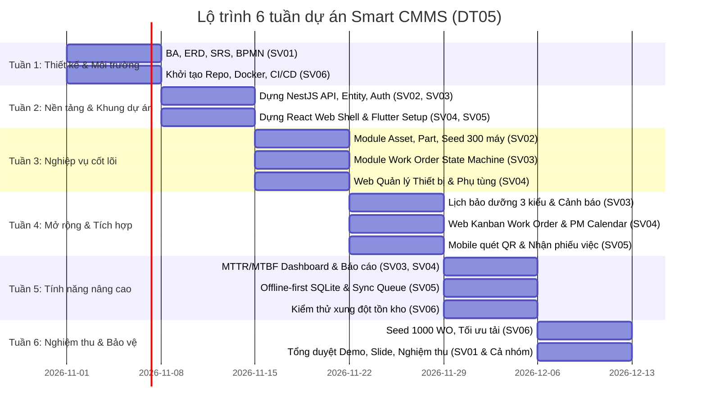

# BẢNG PHÂN CÔNG NHIỆM VỤ CHI TIẾT - DỰ ÁN SMART CMMS (DT05)
**Doanh nghiệp giả định:** ZENTECH COMPANY  
**Quy mô đội ngũ:** 6 thành viên (Leader + 5 thành viên)  
**Thời gian triển khai:** 6 tuần  

---

## 1. TỔNG QUAN PHÂN VAI & TRÁCH NHIỆM CHÍNH (RACI MATRIX)

| Mã SV | Vai trò đảm nhiệm | Trọng tâm công việc | Sản phẩm bàn giao chính (Deliverables) |
|---|---|---|---|
| **SV01 (Leader/Bạn)** | **Team Lead & Core Backend / Security Engineer** | **Trực tiếp Code:** Module Auth (JWT, RBAC), Quản lý người dùng, Hạ tầng Common (Guards, Interceptors, Filters, Base Entity). **Điều phối:** Phân tích yêu cầu (BPMN, SRS), Thiết kế Database ERD, Review PR & Nghiệm thu | Module `AuthModule`, `CommonCore`, Swagger API docs, Tài liệu SRS/BPMN, Đánh giá tiến độ |
| **SV02** | **Backend Engineer (Asset & Parts)** | Quản lý Thiết bị/Tài sản (Asset), Phụ tùng (Parts & Inventory), Lịch sử tài sản, Giao dịch kho | Module NestJS (Asset, Location, Part, PartTransaction), Migration, Seed 300 thiết bị, Unit tests |
| **SV03** | **Backend Engineer (Work Order & Engine)** | Quản lý Phiếu công việc (Work Order), 3 Kiểu Lịch bảo dưỡng (PM), Thuật toán MTTR/MTBF, Idempotency Sync API | Module NestJS (WorkOrder, Schedule, Report, Sync), Cron job tự động, Xử lý xung đột offline, Unit tests |
| **SV04** | **Frontend Engineer (Web Admin & Manager)** | Website Quản trị bằng React + TypeScript: Dashboard KPI, Quản lý tài sản, Work Order, Lịch bảo trì, Kho | Web App hoàn chỉnh kết nối API thật, Quản lý phân quyền (Admin/Manager), Render mã QR, Biểu đồ |
| **SV05** | **Mobile Engineer (Field Technician App)** | Ứng dụng di động Flutter cho Kỹ thuật viên: Quét QR, Nhận việc, Báo cáo sửa chữa, **Offline-first sync** | Mobile App Flutter (Android/iOS), SQLite/Hive local DB, Hàng đợi đồng bộ, Xử lý mất mạng/xung đột |
| **SV06** | **QA & DevOps Engineer** | Hạ tầng Docker Compose, CI/CD GitHub Actions, Dữ liệu mẫu (Seed 1.000 WO), Kịch bản test xung đột & nghiệm thu | Docker Compose (Postgres, pgAdmin, Redis), CI/CD Workflow, Test Plan/Report, Script seed tải lớn |

---

## 2. PHÂN CÔNG CÔNG VIỆC CHI TIẾT CHO TỪNG THÀNH VIÊN

### 👑 SV01 – Team Leader & Core Backend / Security Engineer (BẠN)
* **Mục tiêu:** Giữ vai trò nhạc trưởng điều phối toàn đội ngũ, đồng thời **trực tiếp lập trình phần xương sống bảo mật và hạ tầng dùng chung (Core Architecture)** mà toàn bộ các thành viên khác phải dựa vào để chạy.
* **Đầu việc cụ thể:**
  1. **Nhiệm vụ Quản lý & Thiết kế (Leader & BA):**
     - Thiết lập GitHub Organization/Repository, cấp quyền, cấu hình Branch Protection (yêu cầu ít nhất 1 PR approval trước khi merge vào `develop`/`main`).
     - Viết tài liệu đặc tả yêu cầu (SRS) và vẽ sơ đồ nghiệp vụ BPMN (Quy trình: Báo hỏng $\to$ Work Order $\to$ Kỹ thuật viên $\to$ Vật tư kho $\to$ Nghiệm thu đóng phiếu $\to$ Thống kê MTTR/MTBF).
     - Chốt cấu trúc Database chuẩn 10 bảng cùng SV02 và SV03.
     - Review Pull Requests của các bạn (chú ý kiểm tra convention, SQL Injection, validation pipes).
     - Điều phối họp tiến độ và tổng duyệt bảo vệ đồ án.
  2. **Nhiệm vụ Lập trình trực tiếp (Hands-on Coding):**
     - **Code Module `auth` (Xác thực & Bảo mật):**
       - Đăng nhập JWT, mã hóa mật khẩu bcrypt (`POST /api/v1/auth/login`).
       - API lấy thông tin cá nhân (`GET /api/v1/auth/me`).
       - Quản lý tài khoản người dùng (`users`, `roles`) cho Admin.
     - **Code Tầng `common` (Hạ tầng dùng chung cho cả backend):**
       - Lớp thực thể cơ sở `BaseEntity` (tự động có `id` UUID, `created_at`, `updated_at`).
       - `JwtAuthGuard`: Bảo vệ các API riêng tư.
       - `RolesGuard` & Decorator `@Roles('ADMIN', 'TECHNICIAN')`: Kiểm tra phân quyền RBAC.
       - `HttpExceptionFilter`: Bắt và chuẩn hóa toàn bộ mã lỗi API về JSON chuẩn `{ success: false, statusCode, message, timestamp }`.
       - `TransformInterceptor`: Tự động đóng gói dữ liệu thành công về định dạng `{ success: true, data: ... }`.
       - Cấu hình Swagger OpenAPI (`/api/docs`) chuẩn hóa để SV04 (Web) và SV05 (Mobile) nhìn vào gọi API.

---

### 💻 SV02 – Backend Developer: Asset, Parts & Inventory
* **Mục tiêu:** Xây dựng nền tảng tài sản, vị trí, phụ tùng và lịch sử biến động dữ liệu.
* **Đầu việc cụ thể:**
  1. **Tuần 1 - 2:**
     - Dựng module `LocationModule`: Quản lý vị trí cây thư mục (Nhà xưởng, Khu vực, Dây chuyền).
     - Dựng module `AssetModule`: CRUD tài sản, phân trang, tìm kiếm mã `AST-xxx`, model, số serial, trạng thái (`OPERATIONAL`, `DOWN`, `MAINTENANCE`, `DECOMMISSIONED`).
     - Tích hợp thư viện sinh chuỗi mã QR duy nhất cho tài sản.
  2. **Tuần 3:**
     - Dựng module `PartModule`: Quản lý danh mục phụ tùng, đơn vị tính, số lượng tồn kho `quantity_on_hand`, ngưỡng tối thiểu `minimum_stock`.
     - Dựng module `PartTransactionModule`: Ghi nhận nhập kho, xuất kho cho Work Order, kiểm soát không cho tồn kho bị âm (Transaction locks).
  3. **Tuần 4:**
     - Xây dựng `AssetHistoryModule`: Tự động ghi log mỗi khi tài sản được bảo trì, sửa chữa hoặc thay thế linh kiện (không chỉ cập nhật đè trạng thái).
     - Viết script Migration & Seed Data ban đầu: **Ít nhất 300 thiết bị** và danh mục 50+ phụ tùng công nghiệp của Zentech.
  4. **Tuần 5 - 6:**
     - Viết Unit Test và E2E Test cho module Asset và Part.
     - Hỗ trợ SV04 (Web) và SV05 (Mobile) kết nối API và tối ưu tốc độ tìm kiếm, lọc phân trang.

---

### ⚙️ SV03 – Backend Developer: Work Order, Maintenance & Sync Engine
* **Mục tiêu:** Xây dựng luồng công việc bảo trì, bộ lập lịch tự động, cơ chế tính chỉ số và API đồng bộ offline an toàn.
* **Đầu việc cụ thể:**
  1. **Tuần 1 - 2:**
     - Dựng module `AuthModule`: Xác thực JWT, Role-based Access Control (`ADMIN`, `MAINTENANCE_MANAGER`, `TECHNICIAN`).
     - Dựng `WorkOrderModule`: Quản lý vòng đời Work Order với State Machine nghiêm ngặt:
       $$\text{OPEN} \to \text{ASSIGNED} \to \text{IN\_PROGRESS} \to \text{COMPLETED} \to \text{CLOSED}$$
       (kèm cơ chế hủy `CANCELLED` hoặc tạm dừng `ON_HOLD` có lưu lý do).
  2. **Tuần 3:**
     - Dựng `MaintenanceScheduleModule`: Hỗ trợ **3 kiểu lịch bảo dưỡng**:
       1. *Theo thời gian (Time-based):* Định kỳ X ngày/tuần/tháng $\to$ Cron tự động sinh WO khi đến hạn.
       2. *Theo mức sử dụng (Usage/Meter-based):* Căn cứ giờ chạy máy (ví dụ mỗi 500h).
       3. *Theo tình trạng/ngưỡng (Condition-based):* Ngưỡng nhiệt độ / độ rung vượt mức an toàn.
     - Xây dựng Cron Job / NestJS Scheduler quét và cảnh báo công việc quá hạn.
  3. **Tuần 4 - 5:**
     - Dựng `ReportModule`: Viết công thức tính toán chỉ số hiệu năng:
       - **MTTR (Mean Time To Repair):** $\text{MTTR} = \frac{\sum \text{Thời gian sửa chữa}}{\text{Tổng số lần sửa chữa}}$
       - **MTBF (Mean Time Between Failures):** $\text{MTBF} = \frac{\sum \text{Thời gian máy chạy}}{\text{Số khoảng hỏng hóc}}$
     - Dựng `SyncModule` (Offline Sync API): Tiếp nhận mảng thao tác kèm `operation_uuid` (Idempotency Key), chống gửi trùng lặp, giải quyết xung đột khi nhiều người cùng dùng phụ tùng cuối.
  4. **Tuần 6:**
     - Tối ưu hóa truy vấn trên tập dữ liệu 1.000 Work Orders, viết integration test và hỗ trợ demo.

---

### 🖥️ SV04 – Frontend Web Developer: Admin & Manager Portal
* **Mục tiêu:** Xây dựng giao diện web quản trị chuyên nghiệp, trực quan, hỗ trợ điều hành và theo dõi toàn diện hệ thống.
* **Đầu việc cụ thể:**
  1. **Tuần 1 - 2:**
     - Khởi tạo dự án React + TypeScript (Vite), cài đặt UI Framework (Tailwind CSS, Icon set, Router).
     - Xây dựng màn hình Đăng nhập, Quản lý tài khoản, Layout Admin (Sidebar, Header, Breadcrumbs).
  2. **Tuần 3:**
     - Màn hình **Quản lý tài sản**: Bảng dữ liệu 300+ thiết bị có tìm kiếm, lọc theo tình trạng, xem chi tiết, tính năng in mã QR để dán lên máy móc.
     - Màn hình **Quản lý phụ tùng**: Bảng tồn kho, cảnh báo phụ tùng sắp hết theo ngưỡng `minimum_stock`, form nhập/xuất kho.
  3. **Tuần 4:**
     - Màn hình **Work Order**: Chế độ xem Danh sách & Bảng Kanban theo các cột trạng thái (`OPEN`, `ASSIGNED`, `IN_PROGRESS`, `COMPLETED`, `CLOSED`). Form tạo phiếu, phân công kỹ thuật viên, xem phụ tùng sử dụng.
     - Màn hình **Lịch bảo dưỡng (PM)**: Giao diện lịch (Calendar view), tạo lịch theo 3 kiểu, danh sách công việc sắp đến hạn và quá hạn màu đỏ.
  4. **Tuần 5:**
     - Màn hình **Dashboard Quản trị**: Hiển thị KPI MTTR, MTBF, biểu đồ tỉ lệ tình trạng thiết bị, biểu đồ mức độ ưu tiên của Work Order, danh sách việc cần xử lý khẩn cấp.
  5. **Tuần 6:**
     - Tinh chỉnh UI/UX, responsive, kiểm tra luồng hoạt động mượt mà với API thật từ SV02/SV03.

---

### 📱 SV05 – Mobile Developer: Field Technician App
* **Mục tiêu:** Xây dựng ứng dụng di động cho Kỹ thuật viên hiện trường, hoạt động trơn tru cả khi vào khu vực nhà xưởng mất sóng (Offline-First).
* **Đầu việc cụ thể:**
  1. **Tuần 1 - 2:**
     - Khởi tạo dự án Flutter (Clean Architecture: presentation, domain, data).
     - Màn hình Đăng nhập cho kỹ thuật viên và lưu token an toàn.
     - Tích hợp thư viện Camera / QR Code Scanner để quét mã tài sản trên thiết bị (`AST-xxx`).
  2. **Tuần 3:**
     - Màn hình **Danh sách Work Order được giao**: Lọc theo độ ưu tiên (Khẩn cấp, Cao, Trung bình, Thấp).
     - Màn hình **Chi tiết công việc & Thực hiện sửa chữa**: Bấm "Bắt đầu làm" $\to$ chuyển `IN_PROGRESS`, chọn phụ tùng thay thế, nhập ghi chú xử lý, bấm "Hoàn thành" $\to$ chuyển `COMPLETED`.
  3. **Tuần 4 - 5: CƠ CHẾ OFFLINE SYNC (Trọng tâm cốt lõi)**:
     - Tích hợp SQLite / Hive / Isar lưu trữ cục bộ trên máy điện thoại.
     - Khi mất mạng: Tất cả thao tác (nhận việc, cập nhật trạng thái, dùng vật tư) được sinh 1 mã UUID và lưu vào Hàng đợi chờ (`PENDING`). Kỹ thuật viên vẫn tiếp tục làm việc bình thường.
     - Khi có mạng: Tự động phát hiện kết nối hoặc cho phép bấm "Đồng bộ ngay", gửi danh sách thao tác lên Backend Sync API.
     - Giao diện quản lý đồng bộ: Hiển thị rõ thao tác nào đã gửi thành công (`SYNCED`), thao tác nào đang chờ, thao tác nào bị từ chối/xung đột (`CONFLICT`).
  4. **Tuần 6:**
     - Đóng gói file APK chạy thử nghiệm trên máy thật Android, diễn tập kịch bản demo ngắt Wi-Fi/4G cho buổi nghiệm thu.

---

### 🛠️ SV06 – QA & DevOps Engineer: CI/CD, Testing & Large Scale Seed
* **Mục tiêu:** Đảm bảo toàn bộ hệ thống chuẩn hóa môi trường, tự động hóa build/test, kiểm thử đạt chỉ tiêu 300 thiết bị & 1.000 Work Order.
* **Đầu việc cụ thể:**
  1. **Tuần 1 - 2:**
     - Viết file `docker-compose.yml` chuẩn hóa PostgreSQL, pgAdmin và Redis để toàn bộ nhóm chỉ cần 1 lệnh là có DB sẵn sàng.
     - Thiết lập GitHub Actions Workflow (`ci.yml`): Tự động chạy lint, unit test và build backend/frontend mỗi khi có thành viên tạo Pull Request.
  2. **Tuần 3:**
     - Lập **Test Plan** tổng thể cho 6 tuần: Danh sách Test Cases chi tiết với: Mã test, Đầu vào, Các bước thực hiện, Kết quả mong đợi, Kết quả thực tế.
     - Viết bộ Postman Collection kiểm thử tự động toàn bộ API của SV02 và SV03.
  3. **Tuần 4:**
     - Viết kịch bản và script sinh dữ liệu lớn:
       - **300 Thiết bị (Assets)** với đủ loại máy (máy nén khí, bơm, CNC, trạm biến áp, motor).
       - **1.000 Work Orders** có lịch sử thực tế trong 6 tháng qua để phục vụ tính MTTR và MTBF chính xác.
  4. **Tuần 5 - 6:**
     - Thực hiện kiểm thử kịch bản khó: **Xung đột đồng bộ (Conflict Test)**: 2 kỹ thuật viên cùng nhận việc hoặc cùng xuất phụ tùng cuối cùng khi offline $\to$ chứng minh server xử lý an toàn không để tồn kho âm.
     - Lập **Test Report** hoàn chỉnh kèm ảnh chụp minh chứng cho từng mục nghiệm thu của đề tài.

---

## 3. LỘ TRÌNH 6 TUẦN TRIỂN KHAI DỰ ÁN (MILESTONES)

---

## 4. CHECKLIST NGHIỆM THU THEO YÊU CẦU ĐỀ BÀI

| Mục nghiệm thu | Chỉ tiêu cần chứng minh | Người phụ trách chính |
|---|---|---|
| **1. 300 thiết bị** | Seed dữ liệu thành công; tìm kiếm theo mã/tên, phân trang mượt mà, xem chi tiết và in mã QR. | SV02, SV04, SV06 |
| **2. 1.000 Work Orders** | Sinh đủ 1.000 phiếu trong DB; lọc theo trạng thái, ngày tháng và hiển thị báo cáo không bị giật/lag. | SV03, SV04, SV06 |
| **3. 3 Kiểu lịch bảo dưỡng** | Demo được: (1) Theo thời gian, (2) Theo số giờ chạy máy, (3) Theo ngưỡng cảnh báo nhiệt/rung. | SV03, SV04 |
| **4. Đồng bộ Offline/Online** | Tắt mạng trên điện thoại $\to$ ghi nhận sửa chữa $\to$ bật lại mạng $\to$ Server nhận và lưu thành công. | SV05, SV03 |
| **5. Xử lý xung đột** | Tạo tình huống 2 người thao tác mâu thuẫn $\to$ hệ thống phát hiện và báo lỗi hợp lý. | SV03, SV05, SV06 |
| **6. Chỉ số MTTR & MTBF** | Chứng minh công thức tính toán từ dữ liệu sửa chữa thực tế, biểu đồ trực quan trên Dashboard. | SV03, SV04 |
| **7. CI/CD tự động** | Đẩy code lên GitHub $\to$ GitHub Actions tự động chạy test và build thành công. | SV06 |
