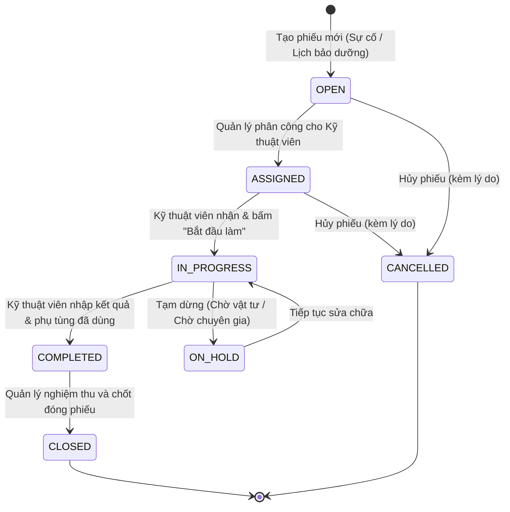

# THIẾT KẾ KIẾN TRÚC & DATABASE SCHEMA (DT05 - SMART CMMS)

## 1. TỔNG QUAN KIẾN TRÚC HỆ THỐNG

Hệ thống được thiết kế theo kiến trúc Client - Server hiện đại với 3 tầng chính:
- **Tầng Giao diện (Presentation Layer):**
  - **Web Portal:** React + TypeScript (Vite) dành cho Quản lý & Admin điều hành.
  - **Mobile App:** Flutter dành cho Kỹ thuật viên hiện trường (hỗ trợ quét mã QR & Offline-first SQLite).
- **Tầng Nghiệp vụ (Application Layer):**
  - **NestJS Framework:** Cung cấp RESTful API, xác thực JWT, Guard phân quyền theo vai trò (RBAC), Swagger OpenAPI, Cron jobs tự động hóa bảo trì.
- **Tầng Dữ liệu (Data Layer):**
  - **PostgreSQL 16:** Lưu trữ cơ sở dữ liệu quan hệ chính (ACID transaction đảm bảo không bị sai lệch kho khi nhiều người cùng xuất vật tư).
  - **Redis (Tùy chọn):** Cache chỉ số Dashboard và hàng đợi xử lý nền khi mở rộng quy mô.

```
       [ React Web Portal ]         [ Flutter Mobile App ]
          (Admin/Manager)                (Technician)
                \                             /
                 \                           / (REST API / Offline Sync)
                  v                         v
               +-------------------------------+
               |    NestJS Backend API (v1)    |
               |  (Auth, Asset, WO, PM, Sync)  |
               +-------------------------------+
                               |
               +---------------+---------------+
               |                               |
               v                               v
       [ PostgreSQL 16 ]               [ Redis Cache ]
      (Primary Database)               (Optional Queue)
```

---

## 2. THIẾT KẾ CHI TIẾT 10 BẢNG DATABASE CHUẨN

### 2.1. Bảng `roles` & `users` (Xác thực & Phân quyền)
```sql
CREATE TABLE roles (
    id SERIAL PRIMARY KEY,
    name VARCHAR(50) UNIQUE NOT NULL, -- 'ADMIN', 'MAINTENANCE_MANAGER', 'TECHNICIAN'
    description VARCHAR(255),
    created_at TIMESTAMP DEFAULT CURRENT_TIMESTAMP
);

CREATE TABLE users (
    id UUID PRIMARY KEY DEFAULT gen_random_uuid(),
    username VARCHAR(50) UNIQUE NOT NULL,
    email VARCHAR(100) UNIQUE NOT NULL,
    password_hash VARCHAR(255) NOT NULL,
    full_name VARCHAR(100) NOT NULL,
    phone_number VARCHAR(20),
    role_id INT NOT NULL REFERENCES roles(id),
    is_active BOOLEAN DEFAULT TRUE,
    created_at TIMESTAMP DEFAULT CURRENT_TIMESTAMP,
    updated_at TIMESTAMP DEFAULT CURRENT_TIMESTAMP
);
```

### 2.2. Bảng `locations` & `assets` (Cấu trúc vị trí & Thiết bị)
```sql
CREATE TABLE locations (
    id UUID PRIMARY KEY DEFAULT gen_random_uuid(),
    name VARCHAR(100) NOT NULL, -- Ví dụ: "Xưởng 1", "Dây chuyền Đóng gói", "Khu kỹ thuật"
    code VARCHAR(50) UNIQUE NOT NULL, -- "LOC-X1"
    parent_location_id UUID REFERENCES locations(id) ON DELETE SET NULL,
    description TEXT,
    created_at TIMESTAMP DEFAULT CURRENT_TIMESTAMP
);

CREATE TABLE assets (
    id UUID PRIMARY KEY DEFAULT gen_random_uuid(),
    asset_code VARCHAR(50) UNIQUE NOT NULL, -- Ví dụ: "AST-001" (Được mã hóa vào QR Code)
    name VARCHAR(150) NOT NULL,
    category VARCHAR(100), -- Ví dụ: "Máy nén khí", "Động cơ điện", "Bơm thủy lực", "Máy CNC"
    manufacturer VARCHAR(100),
    model VARCHAR(100),
    serial_number VARCHAR(100),
    location_id UUID REFERENCES locations(id) ON DELETE SET NULL,
    status VARCHAR(30) DEFAULT 'OPERATIONAL', -- 'OPERATIONAL', 'DOWN', 'MAINTENANCE', 'DECOMMISSIONED'
    install_date DATE,
    warranty_expiry_date DATE,
    operating_hours NUMERIC(10, 2) DEFAULT 0.00, -- Số giờ vận hành tích lũy
    qr_code_url TEXT,
    created_at TIMESTAMP DEFAULT CURRENT_TIMESTAMP,
    updated_at TIMESTAMP DEFAULT CURRENT_TIMESTAMP
);
```

### 2.3. Bảng `work_orders` & `asset_history` (Phiếu sửa chữa & Nhật ký)
```sql
CREATE TABLE work_orders (
    id UUID PRIMARY KEY DEFAULT gen_random_uuid(),
    work_order_code VARCHAR(50) UNIQUE NOT NULL, -- Ví dụ: "WO-2026-0001"
    asset_id UUID NOT NULL REFERENCES assets(id) ON DELETE CASCADE,
    title VARCHAR(200) NOT NULL,
    description TEXT,
    type VARCHAR(30) NOT NULL, -- 'CORRECTIVE' (Sửa chữa sự cố), 'PREVENTIVE' (Bảo dưỡng định kỳ)
    priority VARCHAR(20) DEFAULT 'MEDIUM', -- 'LOW', 'MEDIUM', 'HIGH', 'CRITICAL'
    status VARCHAR(30) DEFAULT 'OPEN', -- 'OPEN', 'ASSIGNED', 'IN_PROGRESS', 'COMPLETED', 'CLOSED', 'CANCELLED'
    assigned_to UUID REFERENCES users(id) ON DELETE SET NULL, -- Kỹ thuật viên đảm nhiệm
    created_by UUID REFERENCES users(id) ON DELETE SET NULL,
    due_date TIMESTAMP,
    started_at TIMESTAMP,
    completed_at TIMESTAMP,
    actual_duration_hours NUMERIC(6, 2), -- Thời gian sửa chữa thực tế (dùng tính MTTR)
    technician_notes TEXT,
    created_at TIMESTAMP DEFAULT CURRENT_TIMESTAMP,
    updated_at TIMESTAMP DEFAULT CURRENT_TIMESTAMP
);

CREATE TABLE asset_history (
    id UUID PRIMARY KEY DEFAULT gen_random_uuid(),
    asset_id UUID NOT NULL REFERENCES assets(id) ON DELETE CASCADE,
    work_order_id UUID REFERENCES work_orders(id) ON DELETE SET NULL,
    action_type VARCHAR(50) NOT NULL, -- 'STATUS_CHANGED', 'REPAIRED', 'PARTS_REPLACED', 'INSPECTED'
    description TEXT NOT NULL,
    performed_by UUID REFERENCES users(id) ON DELETE SET NULL,
    created_at TIMESTAMP DEFAULT CURRENT_TIMESTAMP
);
```

### 2.4. Bảng `maintenance_schedules` (3 Kiểu Lịch Bảo Dưỡng Định Kỳ)
```sql
CREATE TABLE maintenance_schedules (
    id UUID PRIMARY KEY DEFAULT gen_random_uuid(),
    asset_id UUID NOT NULL REFERENCES assets(id) ON DELETE CASCADE,
    title VARCHAR(200) NOT NULL,
    description TEXT,
    schedule_type VARCHAR(30) NOT NULL, -- 'TIME_BASED', 'USAGE_BASED', 'CONDITION_BASED'
    
    -- 1. Tham số cho Lịch theo thời gian (Time-based):
    interval_days INT, -- Ví dụ: lặp lại mỗi 30 ngày, 90 ngày
    
    -- 2. Tham số cho Lịch theo mức sử dụng (Usage-based):
    usage_interval_hours NUMERIC(10, 2), -- Ví dụ: lặp lại sau mỗi 500 giờ chạy máy
    last_service_hours NUMERIC(10, 2) DEFAULT 0.00,
    
    -- 3. Tham số cho Lịch theo tình trạng/ngưỡng (Condition-based):
    condition_metric VARCHAR(50), -- Ví dụ: "TEMPERATURE", "VIBRATION"
    condition_threshold NUMERIC(10, 2), -- Ngưỡng kích hoạt, ví dụ 85 độ C hoặc độ rung 5mm/s
    
    last_triggered_at TIMESTAMP,
    next_due_at TIMESTAMP,
    is_active BOOLEAN DEFAULT TRUE,
    created_at TIMESTAMP DEFAULT CURRENT_TIMESTAMP
);
```

### 2.5. Bảng `parts`, `work_order_parts` & `part_transactions` (Quản lý Phụ tùng)
```sql
CREATE TABLE parts (
    id UUID PRIMARY KEY DEFAULT gen_random_uuid(),
    part_code VARCHAR(50) UNIQUE NOT NULL, -- Ví dụ: "PART-BEARING-6205", "PART-FILTER-01"
    name VARCHAR(150) NOT NULL,
    unit VARCHAR(30) DEFAULT 'Cái', -- 'Cái', 'Bộ', 'Lít', 'Mét'
    unit_cost NUMERIC(12, 2) DEFAULT 0.00,
    quantity_on_hand INT NOT NULL DEFAULT 0,
    minimum_stock INT NOT NULL DEFAULT 5, -- Ngưỡng cảnh báo tồn kho tối thiểu
    location_bin VARCHAR(50), -- Vị trí ngăn kệ kho
    created_at TIMESTAMP DEFAULT CURRENT_TIMESTAMP,
    updated_at TIMESTAMP DEFAULT CURRENT_TIMESTAMP
);

CREATE TABLE work_order_parts (
    id UUID PRIMARY KEY DEFAULT gen_random_uuid(),
    work_order_id UUID NOT NULL REFERENCES work_orders(id) ON DELETE CASCADE,
    part_id UUID NOT NULL REFERENCES parts(id) ON DELETE RESTRICT,
    quantity_used INT NOT NULL CHECK (quantity_used > 0),
    unit_price NUMERIC(12, 2) NOT NULL,
    created_at TIMESTAMP DEFAULT CURRENT_TIMESTAMP
);

CREATE TABLE part_transactions (
    id UUID PRIMARY KEY DEFAULT gen_random_uuid(),
    part_id UUID NOT NULL REFERENCES parts(id) ON DELETE RESTRICT,
    work_order_id UUID REFERENCES work_orders(id) ON DELETE SET NULL,
    transaction_type VARCHAR(20) NOT NULL, -- 'INBOUND' (Nhập kho), 'OUTBOUND' (Xuất kho sửa chữa), 'ADJUSTMENT' (Kiểm kê cân kho)
    quantity INT NOT NULL, -- Dương khi nhập, âm khi xuất
    stock_after INT NOT NULL,
    notes TEXT,
    created_by UUID REFERENCES users(id) ON DELETE SET NULL,
    created_at TIMESTAMP DEFAULT CURRENT_TIMESTAMP
);
```

### 2.6. Bảng `sync_operations` (Idempotency & Đồng bộ Offline/Online)
```sql
CREATE TABLE sync_operations (
    id UUID PRIMARY KEY DEFAULT gen_random_uuid(),
    client_operation_uuid UUID UNIQUE NOT NULL, -- Mã do Mobile sinh khi offline để chống xử lý trùng lặp
    user_id UUID NOT NULL REFERENCES users(id),
    operation_type VARCHAR(50) NOT NULL, -- 'START_WORK_ORDER', 'COMPLETE_WORK_ORDER', 'USE_PART'
    payload JSONB NOT NULL,
    status VARCHAR(20) NOT NULL, -- 'PROCESSED', 'FAILED', 'CONFLICT'
    error_message TEXT,
    processed_at TIMESTAMP DEFAULT CURRENT_TIMESTAMP
);
```

---

## 3. WORKFLOW TRẠNG THÁI WORK ORDER (STATE MACHINE)



*Quy tắc nghiệp vụ:*
1. Frontend hoặc Mobile **không được phép** tự ý đổi status bất kỳ. Mỗi bước chuyển trạng thái phải đi qua API kiểm tra quyền (RBAC) và điều kiện hợp lệ.
2. Khi chuyển từ `IN_PROGRESS` $\to$ `COMPLETED`: Phải có thời gian bắt đầu, kết thúc, ghi chú công việc và phụ tùng sử dụng (nếu có).
3. Khi phiếu chuyển sang `COMPLETED`: Hệ thống tự động trừ kho và ghi bản ghi vào `asset_history` và `part_transactions`.

---

## 4. CÔNG THỨC VÀ Ý NGHĨA CHỈ SỐ BẢO TRÌ

### 4.1. MTTR – Mean Time To Repair (Thời gian sửa chữa trung bình)
$$\text{MTTR} = \frac{\text{Tổng thời gian thực hiện sửa chữa (giờ)}}{\text{Tổng số lần hoàn thành Work Order (Corrective)}}$$
* **Ý nghĩa:** Đo lường tốc độ xử lý sự cố của đội ngũ bảo trì. **Càng thấp càng tốt.**

### 4.2. MTBF – Mean Time Between Failures (Thời gian trung bình giữa các lần hỏng)
$$\text{MTBF} = \frac{\text{Tổng thời gian máy chạy ổn định (giờ)}}{\text{Số lần phát sinh sự cố hỏng hóc}}$$
* **Ý nghĩa:** Đo lường độ tin cậy và độ bền của thiết bị kỹ thuật trong nhà xưởng. **Càng cao càng tốt.**

---

## 5. GIAO THỨC ĐỒNG BỘ OFFLINE-FIRST CHO MOBILE

1. **Khi Kỹ thuật viên thao tác lúc mất mạng:**
   - Flutter sinh 1 mã định danh `client_operation_uuid = UUID v4`.
   - Lưu hành động vào SQLite cục bộ ở trạng thái `PENDING`.
   - Ứng dụng phản hồi ngay trên giao diện giúp kỹ thuật viên làm việc liên tục không bị gián đoạn.
2. **Khi có kết nối mạng trở lại:**
   - Mobile gửi một mảng các operations chờ lên endpoint: `POST /api/v1/sync/batch`.
   - Backend mở một Database Transaction:
     - Kiểm tra trong bảng `sync_operations`: Nếu `client_operation_uuid` đã tồn tại $\to$ trả về kết quả cũ (đảm bảo Idempotency, không trừ kho 2 lần nếu đường truyền chập chờn).
     - Kiểm tra xung đột (ví dụ: phụ tùng trong kho đã bị người khác xuất hết trước đó $\to$ đánh dấu trạng thái `CONFLICT` và báo về Mobile để người dùng xử lý).
   - Backend xác nhận thành công $\to$ Mobile đổi trạng thái sang `SYNCED`.
